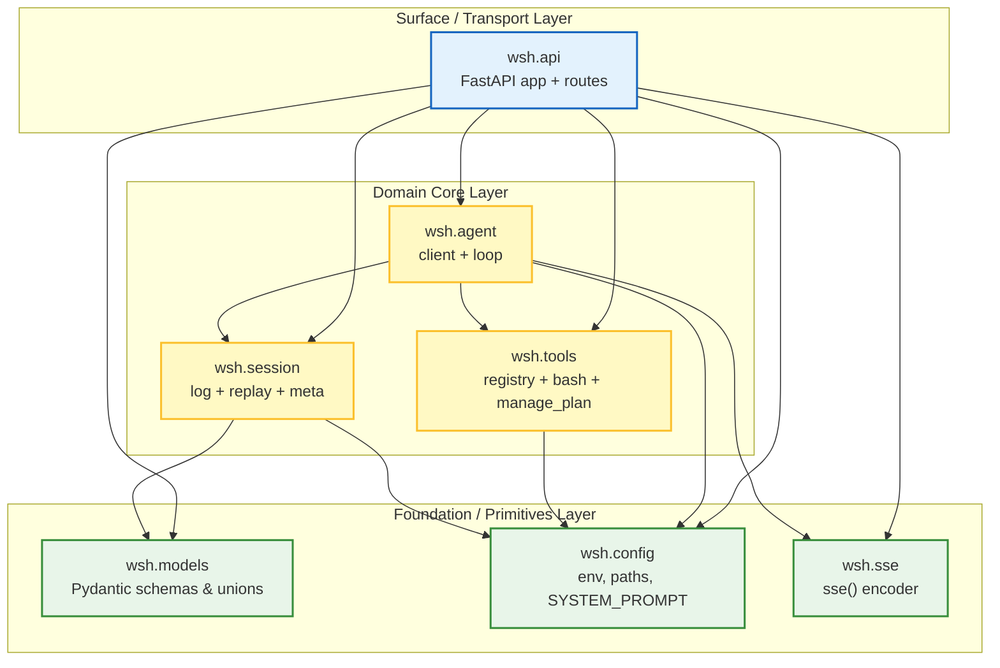

# Backend refactor — design

Requirements: `feature-backend-refactor-requirements.md`.

## Decisions

- **Keep `backend/main.py` as the obvious entrypoint.** It becomes assembly only:
  `from wsh.api.app import app`. `uvicorn main:app` keeps working.
- **`src` layout, package name `wsh`.** All importable code moves under `backend/src/wsh/`.
  `requirements*.txt` disappear; deps live in `pyproject.toml`.
- **`wsh/config.py` is the only side-effectful module.** `load_dotenv()`, env vars,
  `SAMPLE_PROJECT.mkdir()`, `LOGS_DIR`, and `SYSTEM_PROMPT` live here. The side effects are
  accepted; no lazy-import gymnastics to avoid them.
- **`dump_openapi.py` imports `wsh.api.app`, never `main`.** It's fine that importing the app
  reads `.env` / creates the sandbox dir — the point is just that `dump_openapi.py` no longer
  depends on the assembly entrypoint.
- **`wsh/models.py` is the enforced boundary.** Pydantic models + SSE union; it imports
  `pydantic` only and never config/tools/agent/session.
- **Aggressive test pruning.** One test per distinct behaviour; overlapping fixtures/assertions go.
  No exact target count, but the current 32 tests should shrink noticeably.
- **No behaviour change.** Same paths, SSE events, env vars, and wire shapes; the pruned suite is
  the contract.

## Side effects

Importing the app today runs two side effects: `load_dotenv()` (reads `backend/.env`, mutates
`os.environ`) and `SAMPLE_PROJECT.mkdir(exist_ok=True)` (creates `sample-project/`). It does **not**
create `logs/` or a session `.jsonl`; `LOGS_DIR` is only a path, and `SessionLog` creates those at
request time. These import-time side effects are accepted for now; `SAMPLE_PROJECT.mkdir()` may be
removed later.

## Proposed filesystem

```text
backend/
├── pyproject.toml            # name="wsh"; deps + dev-deps; pytest options; hatchling src build
├── main.py                   # assembly only (<60 lines): from wsh.api.app import app
├── dump_openapi.py           # imports wsh.api.app -> app.openapi(); never imports main
├── src/
│   └── wsh/
│       ├── __init__.py
│       ├── config.py         # load_dotenv(), env vars, SAMPLE_PROJECT.mkdir(), LOGS_DIR, SYSTEM_PROMPT
│       ├── models.py         # Pydantic models + SSE union; imports pydantic only; the boundary
│       ├── sse.py            # sse() encoder; stdlib only
│       ├── session/
│       │   ├── __init__.py
│       │   ├── log.py        # SessionLog: append-only WAL, resume/cursor self-heal, now_iso()
│       │   ├── replay.py     # read_records, prepare_session, dangling-tool-call repair
│       │   └── meta.py       # _parse_ts, _updated_at, _session_meta (session-list metadata)
│       ├── tools/
│       │   ├── __init__.py
│       │   ├── registry.py   # @tool decorator, TOOLS, TOOL_REGISTRY, call_tool
│       │   ├── bash.py       # run_bash + @tool bash (uses SAMPLE_PROJECT, BASH_TIMEOUT)
│       │   └── manage_plan.py# @tool manage_plan
│       ├── agent/
│       │   ├── __init__.py
│       │   ├── client.py     # call_model (httpx; uses API_KEY/BASE_URL/MODEL/TOOLS)
│       │   └── loop.py       # agent_loop: yields SSE, runs tool calls
│       └── api/
│           ├── __init__.py
│           ├── app.py        # FastAPI app + CORS + custom_openapi (SseEvent reflection)
│           └── routes.py     # /api/chat, /api/sessions, /api/health; is_safe_session_id()
└── tests/
    ├── conftest.py           # kept: gitignored-path guard
    ├── fixtures/             # kept: frozen session log + README
    ├── test_models.py        # schema smoke (whatever survives pruning)
    ├── test_tools.py         # registry + bash + manage_plan + call_tool
    ├── test_session_log.py   # WAL append/resume/self-heal
    ├── test_replay.py        # prepare_session branches
    ├── test_meta.py          # list metadata/sorting
    └── test_api.py           # endpoint 404/health/sessions
```

## Module dependency graph



Arrows point from importer to imported module. `api` is the composition root, so it imports
every layer below it. `models` is the only enforced boundary — it imports nothing from the
rest of `wsh`.

### Module notes

| Module | Contains | Depends on |
|---|---|---|
| `wsh.config` | `load_dotenv()`, env vars, `SAMPLE_PROJECT`, `LOGS_DIR`, `SYSTEM_PROMPT` | stdlib + python-dotenv |
| `wsh.models` | Pydantic request/response/SSE models + SSE union | pydantic |
| `wsh.sse` | `sse()` | stdlib |
| `wsh.session` | `log.py` (SessionLog WAL + `now_iso`), `replay.py` (prepare_session + repair), `meta.py` (session-list metadata) | config, models |
| `wsh.tools` | `registry.py` (`@tool`, `TOOLS`, `TOOL_REGISTRY`, `call_tool`), `bash.py`, `manage_plan.py` | config |
| `wsh.agent` | `client.py` (`call_model`), `loop.py` (`agent_loop`) | config, session, sse, tools |
| `wsh.api` | `app.py` (FastAPI + CORS + `custom_openapi` + SseEvent reflection), `routes.py` (endpoints) | agent, tools, session, config, models, sse |

Top-level entrypoints: `main.py` imports `wsh.api.app`; `dump_openapi.py` imports `wsh.api.app`.

## `pyproject.toml` sketch

```toml
[project]
name = "wsh"
version = "0.1.0"
requires-python = ">=3.12"
dependencies = [
    "fastapi==0.115.6",
    "uvicorn[standard]==0.34.0",
    "httpx==0.28.1",
    "python-dotenv==1.0.1",
    "pydantic==2.14.1",
]

[dependency-groups]
dev = ["pytest==8.3.4"]

[build-system]
requires = ["hatchling"]
build-backend = "hatchling.build"

[tool.hatch.build.targets.wheel]
packages = ["src/wsh"]

[tool.pytest.ini_options]
testpaths = ["tests"]
```

`uv run pytest` and `uv run python dump_openapi.py …` therefore work on a clean checkout with no
pre-existing `.venv`.

## Test consolidation map

| Old area (in `tests/test_main.py`) | New home | Prune to |
|---|---|---|
| `@tool` registry, schema, `call_tool` | `test_tools.py` | registry+generated schema, sync/async call; drop redundant schema assertions |
| `run_bash` / `bash` | `test_tools.py` | cwd+stdout, exit code, timeout |
| `SessionLog` WAL / resume / self-heal | `test_session_log.py` | delta-not-cumulative, header-once, resume, cursor self-heal |
| `prepare_session` + repair branches | `test_replay.py` | real-log smoke, tool pairing, incomplete, error, bad lines, orphan, both repairs, null-content |
| session list metadata/sorting | `test_meta.py` | tz parse, datetime sort, latest-record, mtime fallback, no-string-sort fields |
| endpoints | `test_api.py` | sessions list/404, health |
| model schemas | `test_models.py` | keep only a discrimination smoke test if it protects the contract |

## Verification

- Record the baseline: `uv run pytest -q` green before touching `main.py`.
- Split, then re-run the pruned suite green with the same assertions that survive.
- `uv run python dump_openapi.py /tmp/schema.json` succeeds.
- `pnpm run check:api` exits 0 (regenerates and shows no diff).
- `git status --porcelain` clean after generation (except the intended deletions/renames).

## Docs

- **README.md (in scope, docs-only).** Update the backend run instructions to `uv sync` /
  `uv run uvicorn main:app --reload --port 8010`, and update the layout diagram: `main.py` is
  now a thin assembly entrypoint, `pyproject.toml` replaces `requirements*.txt`, and the real
  code lives under `backend/src/wsh/`.
- **AGENTS.md (in scope, minimal).** One short repo-root file: the backend/frontend commands
  (`uv run pytest`, `uv run python dump_openapi.py …`, `pnpm build`, `pnpm run check:api`) and
  one line pointing at `plans/` for the SDLC artifacts. No workflow prose — that stays with
  `document-sdlc` (#6).

## Edge cases / risks

- **`SessionLog` default `logs_dir`** currently references `LOGS_DIR`; keep that default in
  `session/log.py` (importing config) to avoid changing call sites, but pass `logs_dir=tmp_path`
  in tests.
- **`main.py` < 60 lines** is a hard gate; if assembly creeps up, move more wiring into
  `api/app.py`.
- **`models.py` boundary** is only as good as the import test/discipline; keep the schema smoke
  test pointed at it and avoid adding imports during the split.

## Out of scope

`session-domain` (#4), `harness-guardrails` (#5), `justfile`, `ruff`/`mypy`/CI gates, new features,
and any behaviour/JSON change. README.md and AGENTS.md are the only docs touched; no other docs.
