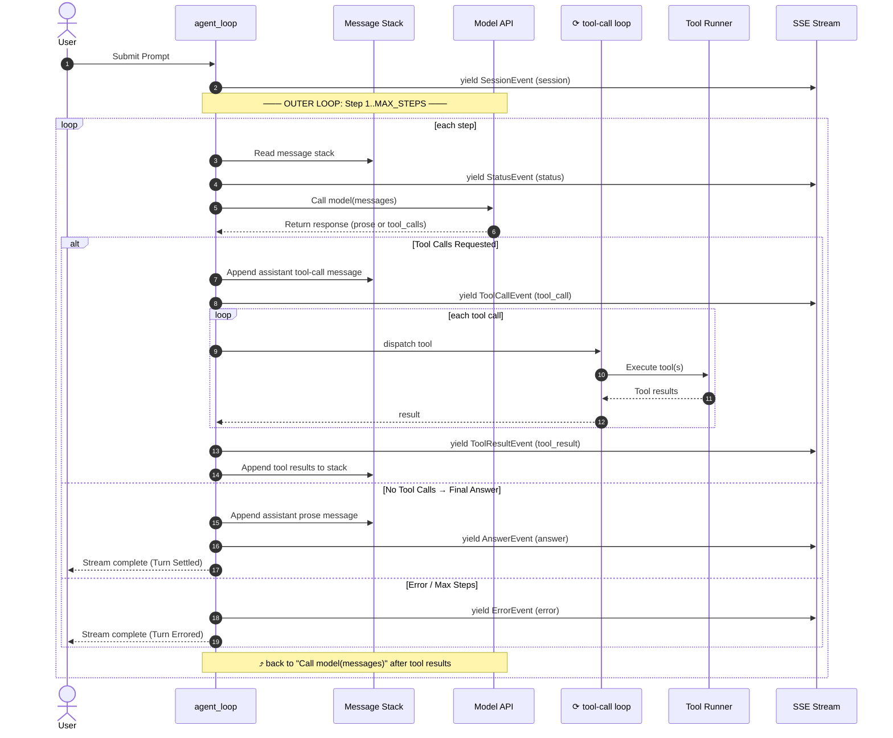

# Feature: Event Loop Cleanup & Typed SSE Contract — Design

## 1. Context & Structural Intent

The event loop is the north star: ask → tool-call → result → answer, streamed over
SSE, logged write-ahead, replayable. The goal is to make the loop *produce* the
contract rather than emit a hand-encoded shadow of it.

Today one shape is written twice:

- **In code** — `agent_loop` yields `sse("answer", {...})` strings, with `sse()`
  doing framing *and* injecting `"type"` into the payload.
- **In a schema** — `models.SseEvent` is the same union, reflected into OpenAPI by
  `app.custom_openapi`, but never produced by the loop.

This design collapses the two: the loop yields `SseEvent` models, and `sse(model)`
is the single encoder.

---

## 2. Sequence Lifecycle

The loop is one outer iteration (ask → branch → repeat) around an inner tool-call
loop. The diagram makes that nesting explicit with a label on the outer `loop` and a
dedicated swimlane for the tool-call loop (`⟳ tool-call loop`), whose own nested
`loop each tool call` routes each dispatch → execute → result cycle through it.

### A single `Note over` is the boundary

The one piece this diagram can't draw as a literal back-arrow is the loop-back from
`tool_results` to the *next* `Call model`. Mermaid sequence diagrams have no goto;
the idiomatic way to convey it is exactly what the diagram does:

- the **outer `loop`** owns the outer repeat (you always come back to the top),
- the **`⟳ tool-call loop` swimlane** owns the inner repeat (one dispatch/execute/
  result cycle per tool, via its nested `loop each tool call`), and
- the trailing **`Note over Agent,LLM: ⤴ back to "Call model(messages)"`** names the
  return path after a batch of tool results.

No dedicated event carries this transition — it is the loop's implicit "next
iteration of the `for step` body".
