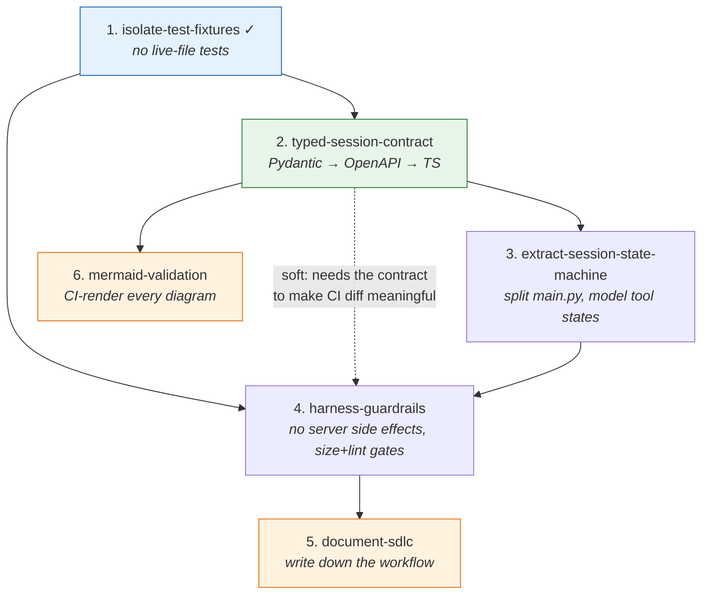

# Follow-up features after `load-jsonl`

None of these block the merge. They are **ordered**: the graph below is the intended execution
order, and each edge is a real dependency (not a preference) unless marked *soft*.

**Critical path:** `1 → 2 → 3 → 4 → 5`. `F6` (mermaid validation) hangs off `F2` and can run any
time after it; it is not on the critical path.

**Why these edges:**
- `1 → 2` — the contract work adds generated types and a CI diff check; doing it before the tests
  are reproducible means the new check itself runs against untracked state.
- `2 → 3` — the state machine's states are the Pydantic models. Refactoring first would mean
  writing the union twice.
- `3 → 4` — a per-function size budget is only enforceable once the 130-line function is split;
  otherwise the linter goes red on day one and gets disabled.
- `1 → 4` — guardrails include "no test reads gitignored state", which `1` establishes.
- `4 → 5` — documenting the SDLC before the guardrails exist would document an aspiration.

---

## 1. `isolate-test-fixtures` — **done**

**Why:** `test_prepare_session_on_real_log` read `../logs/371c7225….jsonl`, which is gitignored.
On a clean clone it failed *quietly* (`assert 0 == 9` — a missing file yields empty turns, not an
error); deleting that session broke the suite.

- [x] Copy one frozen log to `backend/tests/fixtures/` with a short README saying it is frozen
- [x] Point `_REAL_LOG` at the fixture; assert the same 9 turns and no warnings
- [x] Add a test that **fails** if any test references `logs/` or another gitignored path
- [x] Move `test_main.py` → `backend/tests/test_*.py` as part of this (tests dir already implied)

**Verify:** green on a tree with no `logs/` directory. ✅ `uv run pytest -q` → 32 passed with `logs/`
renamed away. The guard is an autouse fixture in `backend/tests/conftest.py` (pathlib `open`/
`read_text`/`exists`/`glob`), not a source grep; it collects violations and fails at teardown.
See `feature-isolate-test-fixtures-retro.md`.

## 2. `typed-session-contract`

**Why:** response shapes are `dict`s; the UI's expectations and the backend's output are kept in
sync by hand. The incident that opened this retro was a *shape* disagreement nothing validated.

**Source of truth: Pydantic → OpenAPI → TypeScript.** Not the reverse.

- [ ] `SessionTurn`, `SessionPayload`, `SessionMeta`, `SseEvent` as Pydantic models (discriminated
      union on `type` for SSE); endpoint return types annotated with them
- [ ] `prepare_session` returns the model, not `dict`; existing tests assert on attributes
- [ ] Generate `frontend/src/api-types.ts` from the OpenAPI schema (`openapi-typescript`)
- [ ] `App.tsx` imports its types from the generated file instead of hand-written `type`s
- [ ] CI check: regenerate and `git diff --exit-code` (this is the automatic guardrail)

**Verify:** `pnpm build` green with zero hand-written API types in `App.tsx`; the CI diff step fails
when a Pydantic field is renamed without regenerating.

## 3. `extract-session-state-machine`

**Why:** `main.py` is 830 lines with six concerns; `prepare_session` is 130 lines with four. Tool
calling is not modelled as a state machine, which is *why* the dangling-`tool_calls` repair exists.

- [ ] Split: `config.py`, `session/` (log, replay, models), `tools/`, `agent/loop.py`, `api/`
- [ ] Model a turn explicitly: `idle → awaiting_user → tool_calls_pending → tool_results →
      answered | incomplete | errored`
- [ ] Make "tool_calls pending" a **state**, not a post-hoc repair branch
- [ ] Keep `_unanswered_tool_call_indexes` only as an assertion that the state machine cannot
      produce an invalid history
- [ ] No behaviour change: the existing suite is the contract

**Verify:** `pytest -q` unchanged and green **before and after** the refactor; no function over ~40
lines; `main.py` gone (or < 60 lines as `app` assembly only).

## 4. `harness-guardrails`

**Why:** I started a server on port 8077 from a tool call. Guardrails belong in the harness, not in
human vigilance.

- [ ] `bash` tool refuses/requires consent for server-starting commands (`uvicorn`, `npm start`, …)
- [ ] `pyproject.toml` + `ruff` (size & complexity budget) + `mypy` on the typed models
- [ ] Pre-commit/CI: lint, type-check, `pytest`, `pnpm build`, OpenAPI diff
- [ ] Document the port policy: never reuse a live port; ask the human to restart

**Verify:** a deliberate `uvicorn` tool call is blocked with a clear message; `ruff`/`mypy` green.

## 5. `document-sdlc` — **held**

**Why:** the `Requirements ↔ Design/Plan ↔ Implement ↔ Review` workflow worked but lives only in
habit and in these artifacts. Writing it down is genuinely valuable — and premature before 4, else it
describes a process without enforcement.

- [ ] One page: the four phases, their artifacts, and the guardrail at each gate
- [ ] Retro template = this file's skeleton (evidence, well, didn't, more, decision archaeology)

**Verify:** `docs/sdlc.md` exists and each phase names its enforcing gate.

## 6. `mermaid-validation` — **held, unreproduced**

**Why:** review reported mermaid blocks that "didn't compile." They do now (both blocks in
`feature-load-jsonl-sequence.md` parse under `mermaid@10`), and the two suspect branches are empty
(0 commits ahead of `main`), so there is no concrete failure to fix.

- [ ] Add a CI step rendering every mermaid block in `plans/` and `docs/`
- [ ] Fail the build on a parse error (no silent diagrams)

**Verify:** a deliberately broken block fails CI.

---

## What this document is *not*

- Not a restart. The feature works; these are increments, sequenced.
- Not a wish for pluggable UI architectures — `2` is the cheap down payment (a schema contract is
  what makes swapping a UI tractable), nothing more.
