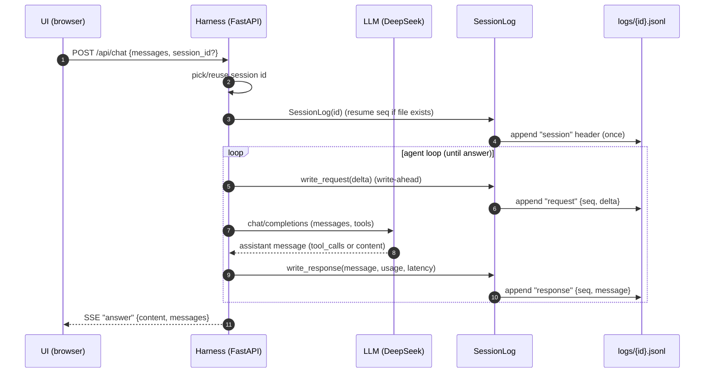
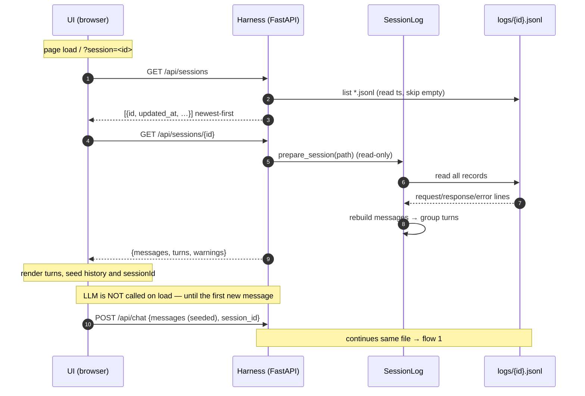

# Load chat sessions from JSONL logs — sequence diagrams

Branch: `feature/load-jsonl` · Design: `plans/feature-load-jsonl-design.md`

Two flows. The key difference: **creating** a session puts the LLM in the loop (each model call is
write-ahead logged before it happens); **loading** one does not touch the LLM at all — it only reads the
log and rebuilds state. The LLM re-enters only when the user sends the first new message.

## 1. Session creation (LLM in the loop)

The browser POSTs the message history; the backend mints/reuses a session id, writes the `session` header
once, then for each step writes the `request` **before** calling the model (WAL) and the `response` after.
Tool calls loop back through the model until it answers in words; the final `answer` returns the updated
history the UI will echo back next turn.

## 2. Session (re)load (no LLM in the loop)

On mount (or deep-link `?session=<id>`) the UI lists and opens a session. The backend only **reads** the
log and rebuilds state; nothing is written and the LLM is not called. The UI seeds its history and
session id from the payload, so the next user message continues the same file — and only *then* does the
LLM re-enter (back to flow 1, appending to the existing log).

