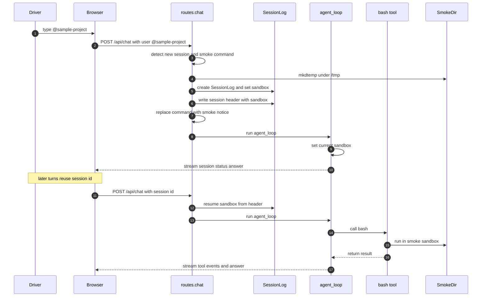

# Sample-project smoke test — design

Requirements: `feature-sample-project-smoke-test-requirements.md`.

The feature adds a **session-scoped smoke mode** to the existing chat loop. It does not
add a new tool, a new event type, or a new API endpoint. The only special-casing lives
in `routes.chat` before the loop starts, and the `bash` tool becomes aware of a
per-session sandbox through a stdlib `ContextVar`.

## Decisions

1. **The `@sample-project` command is a harness command, recognized in `routes.chat`.**
   It is recognized from the first user message of a new session. The raw command never
   reaches the model; it is replaced with a short notice that names the ephemeral
   sandbox. The normal agent loop then runs unchanged.

2. **Smoke mode is persisted in the session log header, not in process state.**
   `SessionLog` gains a `sandbox` attribute. `write_session` already records a
   `sandbox` field; `_resume` now reads it back. A smoke session therefore resumes its
   `/tmp` sandbox on every later turn with no extra request fields or global map.

3. **The active sandbox is a `ContextVar`, not a module global.**
   `wsh/config.py` keeps `SAMPLE_PROJECT` as the default path but stops creating it.
   It adds `set_current_sandbox()` / `get_current_sandbox()`. `agent_loop` sets the
   context var from `log.sandbox` before running tools, and `bash` reads it at call
   time. This keeps the `@tool` registry and `call_tool` untouched.

4. **`config.py` no longer creates directories.**
   `SAMPLE_PROJECT.mkdir()` is removed. Directory creation moves to the `bash` tool
   (lazily, at first use) and to smoke-mode setup. Importing `wsh.config` — and
   therefore `wsh.api.app` — becomes free of sandbox side effects.

5. **The smoke sandbox is a real temp dir under `/tmp`.**
   Smoke setup uses `tempfile.mkdtemp(prefix=f"wsh-smoke-{session_id[:8]}-",
   dir=Path(tempfile.gettempdir()))`. It is left in place after the run for inspection;
   the driver deletes it manually.

6. **Normal mode is unchanged, apart from lazy sandbox creation.**
   No command means `log.sandbox` is `SAMPLE_PROJECT`. The `bash` tool ensures the
   active sandbox directory exists before running, so normal mode still works after a
   manual `rm -rf sample-project/`; the directory is simply created on first use rather
   than at import time.

7. **`manage_plan` is explicitly out of scope for this pass.**
   It remains cwd-relative and is not moved into the smoke sandbox. The smoke runbook
   should prefer prompts that exercise `bash`; the `manage_plan` gap is tracked as an
   open question / follow-up.

## Proposed changes

### `backend/src/wsh/config.py`

- Delete `SAMPLE_PROJECT.mkdir(exist_ok=True)`.
- Add a `ContextVar[Path]` defaulting to `SAMPLE_PROJECT`.
- Add `set_current_sandbox(path: Path)` and `get_current_sandbox() -> Path`.
- Replace the fixed `SYSTEM_PROMPT` with a template plus
  `make_system_prompt(sandbox: Path = SAMPLE_PROJECT) -> str`, so the model is told
  the actual session sandbox.

### `backend/src/wsh/session/log.py`

- Import `SAMPLE_PROJECT`.
- Give `SessionLog.__init__` an optional `sandbox: Path | None = None` parameter.
- Set `self.sandbox` to the provided path or `SAMPLE_PROJECT` before resuming.
- In `_resume`, when the file has a `session` record with a `sandbox` field, set
  `self.sandbox` from that record.
- `write_session` continues to take `sandbox` as a string; `routes.chat` passes
  `str(log.sandbox)`.

### `backend/src/wsh/tools/bash.py`

- Import `get_current_sandbox` instead of `SAMPLE_PROJECT`.
- In `run_bash`, compute `sandbox = get_current_sandbox()`, then
  `sandbox.mkdir(parents=True, exist_ok=True)`, and pass `cwd=sandbox` to
  `create_subprocess_shell`.

### `backend/src/wsh/agent/loop.py`

- Import `set_current_sandbox` (and `SAMPLE_PROJECT` for a defensive default).
- At the top of `agent_loop`, call
  `set_current_sandbox(getattr(log, "sandbox", SAMPLE_PROJECT))`.
- No other loop changes.

### `backend/src/wsh/api/routes.py`

- Add the command helpers:
  - `SMOKE_COMMAND = "@sample-project"`.
  - `_first_user_message(messages)`.
  - `_is_smoke_command(messages)` — true when the first user message is exactly
    `@sample-project` or starts with `@sample-project `.
  - `_replace_smoke_command(messages, sandbox)` — replace that first user message
    with `Smoke mode enabled. Ephemeral sandbox: <sandbox>.`; any trailing text after
    the command becomes `First task: <rest>`.
  - `_new_smoke_sandbox(session_id)` — thin wrapper around
    `tempfile.mkdtemp(prefix=f"wsh-smoke-{session_id[:8]}-", dir=Path(tempfile.gettempdir()))`,
    kept separate so tests can monkeypatch it without touching the real `tempfile`.
- In `chat()`:
  1. Mint/reuse the session id as today.
  2. `log = SessionLog(session_id)`.
  3. If `_is_smoke_command(req.messages)` and `not log.path.exists()`, set
     `log.sandbox = Path(_new_smoke_sandbox(session_id))`.
  4. `system_prompt = make_system_prompt(log.sandbox)`.
  5. `log.write_session(..., sandbox=str(log.sandbox), system_prompt=system_prompt, ...)`.
  6. Build `convo` from `req.messages` minus `system` messages; if the command is
     present, run `_replace_smoke_command`.
  7. Prepend `{"role": "system", "content": system_prompt}` and stream the loop as
     today.

### No frontend changes

The browser already treats the command as a normal user turn, keeps the returned
`session_id`, and echoes back the message history from `answer` events. After the
first turn, the history contains the replacement notice, not the raw `@sample-project`.

## Smoke session lifecycle

## Edge cases / risks

- **Command on an existing session.** If a replayed history still contains a raw
  `@sample-project` first message, `routes.chat` will replace it before the model call
  but will **not** create a new sandbox: `log.path.exists()` is true and the header
  already owns the session sandbox.
- **Normal mode after `rm -rf sample-project/`.** `bash` recreates the active sandbox
  lazily. Importing the app or dumping the schema does not.
- **ContextVar scope.** `set_current_sandbox()` is called inside the async generator
  body before any tool runs. `bash` executes in the same task context, so it sees the
  value. Each request is its own task/context, so sessions do not leak into one
  another.
- **`manage_plan` can still escape the smoke sandbox.** It uses cwd-relative paths and
  is not changed here. A smoke prompt that leads the model to call `manage_plan` could
  write outside `/tmp`. Mitigation: the runbook drives `bash`-only prompts for now, and
  the gap is recorded as a follow-up.
- **Trailing command text.** `@sample-project write a fib util` is accepted; the text
  after the command becomes the first task. Exact `@sample-project` gives only the
  smoke notice and waits for the driver's next prompt.
- **Old logs without a sandbox header.** `_resume` leaves `self.sandbox` at
  `SAMPLE_PROJECT`; old sessions behave like normal mode.

## Test plan

- `test_session_log.py`: resuming a log with a `session` header restores
  `log.sandbox`; a missing/blank header falls back to `SAMPLE_PROJECT`.
- `test_tools.py`: `run_bash` runs in `get_current_sandbox()` when a context var is
  set; it creates the active sandbox if missing.
- `test_api.py`: command helpers recognize exact/prefix `@sample-project` and reject
  other messages; `_replace_smoke_command` removes the raw command and includes the
  sandbox notice.
- `test_api.py` (smoke chat route, with `agent_loop`/`_new_smoke_sandbox`
  monkeypatched): a new smoke session writes a `/tmp`-style sandbox into the log
  header, and the model message does not contain the raw command; a normal session
  still uses `SAMPLE_PROJECT`.
- Existing suite stays green after adapting `test_run_bash_cwd_and_stdout` away from
  any import-time directory assumption.

## Verification

- `cd backend && UV_CACHE_DIR=/tmp/uv-cache-wsh uv run pytest -q` green.
- `rm -rf sample-project && python -c "import wsh.config"` creates no directory.
- `python -c "from wsh.api.app import app"` creates no sandbox directory.
- Manual smoke run per the runbook (to be written in the plan): real DeepSeek, real
  browser, `@sample-project` first turn, then tool-call and no-tool turns, inspecting
  the `/tmp` sandbox and the session JSONL.
- `git status --porcelain` clean after the smoke run (apart from intended plan docs).

## Out of scope

- New endpoint, new event type, new tool, or frontend changes.
- Automated smoke invocation / CI.
- Making `manage_plan` sandbox-aware.
- General env-configurable sandbox path.
- README/docs/mkdocs updates — plans only for now.

## Open questions

1. **`manage_plan` follow-up.** Do it immediately after this feature, or leave it until
   `harness-guardrails`?
2. **Smoke sandbox naming.** The current design uses
   `/tmp/wsh-smoke-{session_id[:8]}-{random}`. Good enough, or does the driver want a
   fixed, predictable path like `/tmp/wsh-smoke-{full_session_id}`?
3. **Command replacement surface.** Is replacing the first user message acceptable, or
   should the browser hide the command turn too? (Design says backend-only for now.)
