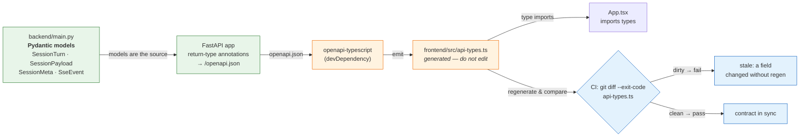
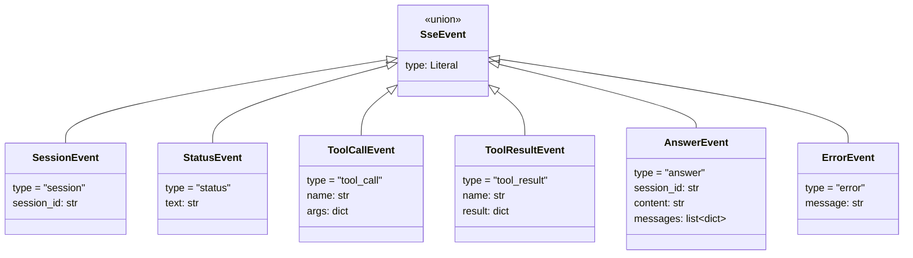
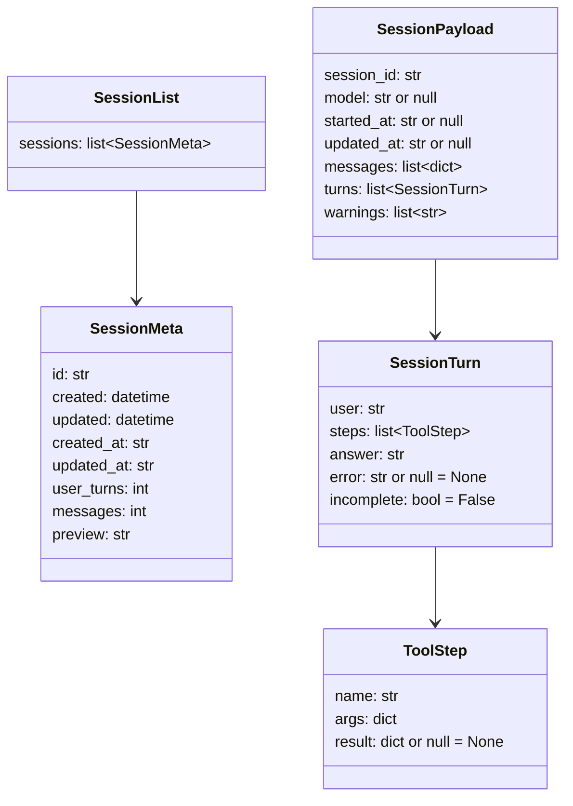

# Typed session contract — design

Requirements: `feature-typed-session-contract-requirements.md`.

## Decisions

- **Direction is one-way:** Pydantic → OpenAPI → TypeScript. The generated TS is a build product,
  never edited; any change is made in `main.py` and regenerated. This is the whole point — one
  authoritative definition, the browser a projection of it.
- **`prepare_session` returns a model, not a `dict`.** Its docstring already documents a `Turn`
  shape; the model makes that the type. Its callers switch from `payload["turns"]` to
  `payload.turns`.
- **SSE as a discriminated union on `type`.** `sse()` already injects `type` into every payload, so
  the runtime contract is unchanged — the models only describe what is already emitted. Each union
  member is a small model whose `type` is a `Literal`; pydantic emits that as a JSON-schema
  discriminator that `openapi-typescript` turns into a TS discriminated union.
- **`datetime` serialises to a string.** `SessionMeta.created`/`updated` are real datetimes (server
  sorts on them). The generated TS sees `string`. The UI must not sort on them — already true; the
  design makes it explicit in the type.
- **Wire format is frozen.** A rename that changes JSON is a bug this feature would *catch*, not fix.
  Field names and values stay identical; only the types move into models.

## Pipeline (generate, then prove it isn't stale)

**Why the diff check works:** `api-types.ts` is committed. If a renamed Pydantic field changes the
schema, the regenerated file differs from the committed one, `git diff --exit-code` exits non-zero,
and CI fails. Nothing else needs to remember to regenerate.

## SSE union

`agent_loop` emits six event kinds. Five are consumed by the UI today; `status` is emitted but the
UI ignores it — it still belongs in the union so the contract is complete.

On the TS side this becomes `SessionEvent | StatusEvent | …`; a `switch (event.type)` then narrows
`event` so `event.content` only exists on `AnswerEvent`. The UI's current `event.content ?? ""`
guards become unnecessary — the compiler proves the access is safe.

## One ledger, four shapes (not "two event families")

Only **one** thing in this system is *written*; everything else is a projection of it. Keep the
directions straight:

| Model | Flow | Persisted? | Source |
|---|---|---|---|
| *(log records)* `session`/`request`/`response`/`error` | backend → `logs/*.jsonl` | **yes** (the ledger) | `SessionLog.write_*` |
| `SessionList` / `SessionMeta` | `GET /api/sessions` → UI | no | **derived** by scanning logs |
| `SessionPayload` / `SessionTurn` | `GET /api/sessions/{id}` → UI | no | **rebuilt** by reading a log |
| `SseEvent` | `/api/chat` stream → UI | no | live, disposable |

`SessionList` is **not** a log event family — it is the body of one HTTP response, computed from
`path.stat()` and a scan of `request.delta`, and then discarded. The log never contains a
`SessionMeta`. The only family that writes is the top row, which this feature deliberately does
**not** model (`extract-session-state-machine`, #3).

## Response models

`messages` and tool `args`/`result` stay `list[dict]` / `dict`: they are the raw OpenAI wire format
and a JSON-schema for the whole conversation is `extract-session-state-machine`'s job, not this one's.

## Annotating the endpoints

- `list_sessions() -> SessionList`
- `get_session(...) -> SessionPayload`
- `prepare_session(path) -> SessionPayload`
- `chat(...) -> StreamingResponse` (SSE body is not in the OpenAPI response schema; `SseEvent` is
  exported as a *reflected* schema so `openapi-typescript` still emits it — see below)

The SSE union is not part of any endpoint's declared response (the body is a stream), so FastAPI
will not put it in `/openapi.json` on its own. **Chosen: reflect it into the OpenAPI components** so
`openapi-typescript` emits `SseEvent` alongside the response models — one generation path, one diff
check. No second schema file, no hand-maintained mirror, and no second validation pass: the stream's
bytes are not validated at runtime by this feature, only its *type* is described.

## Generation wiring

- Add `openapi-typescript` as a frontend devDependency.
- Script: dump `app.openapi()` to JSON (a one-liner invoking the FastAPI app, no running server) →
  `openapi-typescript schema.json -o src/api-types.ts`.
- CI step (added in this feature per requirements #4): run the script, then
  `git diff --exit-code frontend/src/api-types.ts`.

## Edge cases

- **Discriminator literal typing.** Pydantic v2 emits `const`/`discriminator`; `openapi-typescript`
  ≥ 6 maps this to a proper TS union. Pin a version and check the emitted form in the first run.
- **`Optional` vs absent.** UI treats `model`, `started_at` as optional and guards with `??`. As
  `str | None` the generated type is `string | null`, so `??` sites keep working; only `undefined`
  narrowing changes.
- **`SessionTurn.error`/`incomplete`.** Currently only set for some turns, so the model needs
  defaults (`None` / `False`) or the generated TS becomes `boolean | undefined`.
- **Empty `turns`/`sessions`.** Models default to `[]`; no `None` leaks.

## Out of scope

Behaviour and JSON changes; splitting `main.py`; `ruff`/`mypy`/pre-commit (→ `harness-guardrails`).

## Relationship to `SessionLog` (log records vs SSE events)

Both are `type`-tagged JSON streams, which invites the question "can they share one union?" **No —
they are two different contracts that happen to share a discriminator.** Keep them separate.

Measured against the real `_append` payloads and `yield sse(...)` calls:

| | log record types | SSE event types |
|---|---|---|
| tags | `session`, `request`, `response`, `error` | `session`, `status`, `tool_call`, `tool_result`, `answer`, `error` |
| envelope | `seq`, `ts`, `session` | none |

- **Only two tags collide** — `session` and `error` — and **neither means the same thing**.
  - log `session` = the one-time *header* (`model`, `base_url`, `sandbox`, `config`, `system_prompt`,
    `tools`); SSE `session` = `{session_id}`. Same word, near-disjoint fields.
  - log `error` = `{step, message, seq, ts, session}` (a *persisted* failed model call);
    SSE `error` = `{message}` (a *live* notification). The log one carries `step`.
- **The other four SSE events have no log counterpart.** `tool_call`/`tool_result`/`answer`/`status`
  are live-only: the log stores the same information *transformed* — tool calls become
  `response.message.tool_calls`, results become `role:"tool"` messages, the answer becomes
  `response.message.content`. SSE is a *projection for rendering*; the log is the *write-ahead record*.
- **The envelopes differ by design.** Log records get `seq`/`ts`/`session` stamped by `_append`
  (immutable, ordered, replayable). SSE events get `type` injected by `sse()` and nothing else —
  they are disposable; if the browser misses one, it reloads the log.

**Decision: two unions, one home.** `SseEvent` (this feature) and a future `LogRecord` union
(`extract-session-state-machine`, which is where the log's `request`/`response` shape belongs) both
live in `main.py`/`session/`, share nothing but the *pattern*. Attempting one union now would force
`error` to be optional-everything and make the UI's exhaustive `switch` weaker, not stronger.

**What they *should* share** is the vocabulary below them: `ToolStep`, and the OpenAI `message`
dict — which is why `SessionTurn.steps: list[ToolStep]` is defined here and the log's
`response.message.tool_calls` should reuse the same `ToolStep` when the log gets typed.

## Deferred: domain layering (belongs to #3)

An open question raised during review: should the domain be modelled DDD-style — a pure core
(`Session`, `Message`, `ExecutionStep`), application use-cases, infrastructure adapters — with
import-boundary tests (AST or `import-linter`) forbidding `pathlib`/`fastapi`/HTTP clients from the
core?

**Not in this feature.** `SessionLog` is a `pathlib` file writer and `prepare_session(path: Path)`
takes a path; a pure core means re-cutting `main.py`, which is exactly `extract-session-state-machine`
(#3) — its plan already commits to `session/` (log, replay, **models**). Doing it here would mix a
no-behaviour-change type pass with a structural refactor, so a red test would have three causes.
Doing it in #3 has the existing suite as the safety net ("green before and after").

This feature contributes the raw material: the models #3's state machine and domain core are built
from. Carry the layering question into #3's plan, including slice-by-capability (`session/`) vs
slice-by-layer (`domain/` + `infrastructure/`) — the former is the current inclination.
